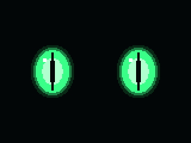
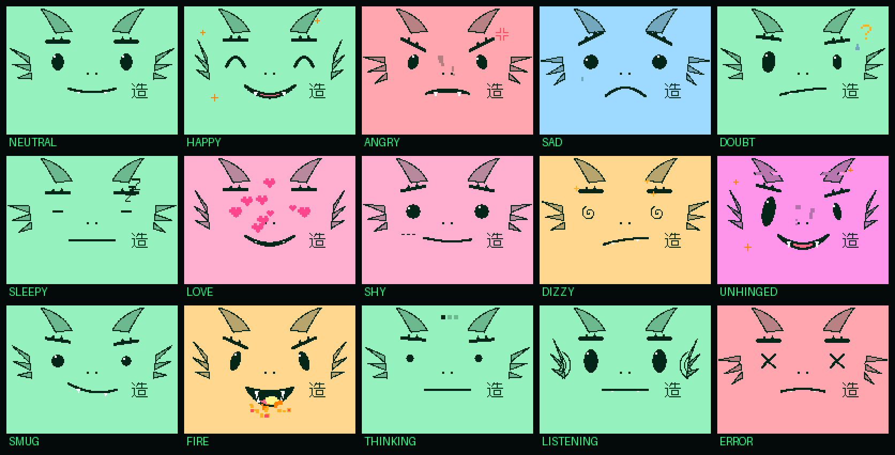
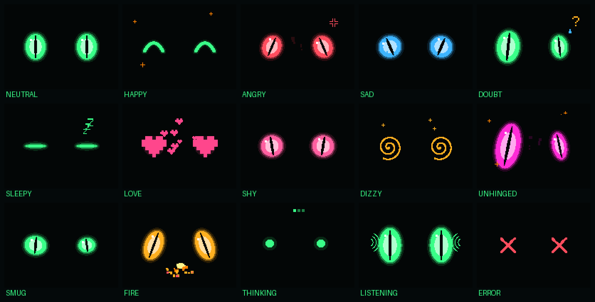

# 🐲 Midoryu

**Midoryu** (*midori* + *ryū*, "dragón verde") es un firmware custom para el robot **StackChan** de M5Stack: cara de dragón en pixel art, personalidad de dragón desquiciado, y la opción de correr el cerebro en tu propia compu.

Construido sobre [m5stack/StackChan](https://github.com/m5stack/StackChan) (MIT) y XiaoZhi ESP32. Full respeto a los dos proyectos.

English version: **[README.md](README.md)**.

  
  &nbsp;&nbsp;
  

## Qué trae

- **Cara de dragón** con 15 expresiones y tatuaje con el kanji 造.
- **Versión solo-ojos**: ojos de dragón brillando sobre fondo negro, sin boca, más liviana.
- Servidor oficial de XiaoZhi por defecto; **servidor propio** en Docker como opción (carpeta `midoryu-server/`).
- StackChan **v1.6.0** de upstream ya integrado.

## Galería

## Cómo flashearlo (paso a paso, sin instalar nada)

1. Baja el `.bin` que quieras desde **Releases** (si dudas: `dragon-official`).
2. Conecta el StackChan a tu compu con el cable USB-C.
3. Ponlo en modo descarga: **mantén el botón de reset unos 3 segundos** hasta que prenda el LED verde interno.
4. Abre <https://espressif.github.io/esptool-js/> en Chrome o Edge.
5. Dale a **Connect**, escoge el puerto USB y confirma.
6. En *Flash Address* escribe `0x0`, dale a **Choose File** y selecciona el `.bin`.
7. Dale a **Program** y espera al 100 %.
8. Pulsa reset una vez. ¡Despierta el dragón! 🐉

## Compilar desde el código

Necesitas **ESP-IDF 5.5.4**. Los pasos están en [README.md](README.md#2-build-from-source) (los comandos son los mismos).

## Servidor propio

Guía completa en español: [midoryu-server/README_ES.md](midoryu-server/README_ES.md).

> 🔑 Nunca subas tu API key al repo ni la pegues en un chat. Si se filtra, bórrala y crea otra.

Licencia MIT.
