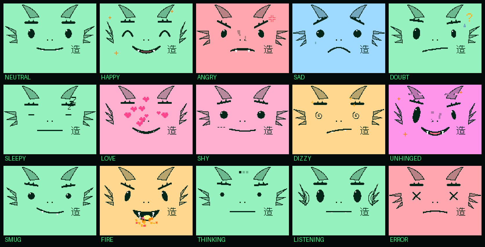
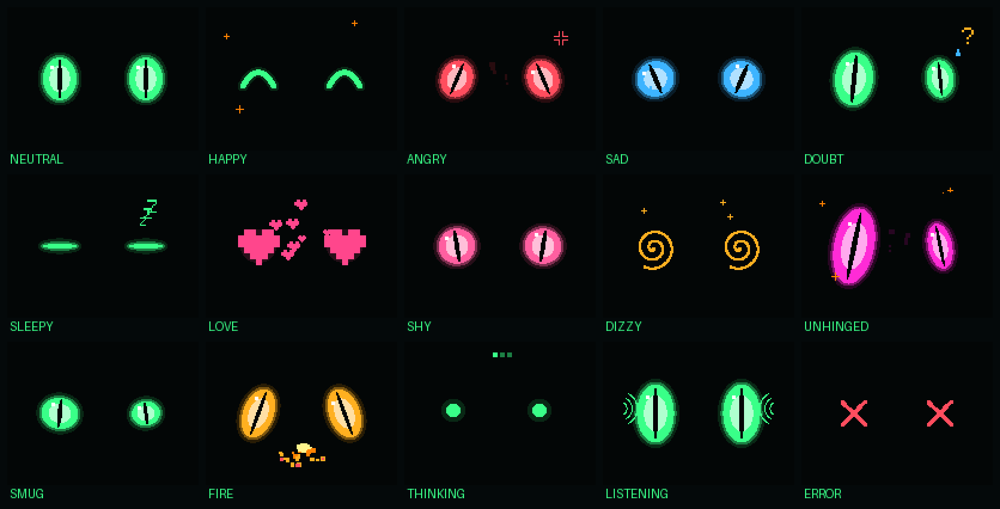

# 🐲 Midoryu

<p align="center">
  
  
  
  
  
</p>

<p align="center">
  
  &nbsp;&nbsp;
  
  <br><sub>Left: full dragon face. Right: eyes-only face. Rendered by the real firmware code.</sub>
</p>

**Midoryu** (*midori* 緑 + *ryū* 竜, "green dragon") is a custom firmware for the **M5Stack StackChan** desktop robot.
Same body, new soul: a pixel-art dragon face, an unhinged dragon personality, and an optional self-hosted voice server so the brain can run on your own PC.

> 🇩🇴 ¿Prefieres español? Lee **[README.es.md](README.es.md)**.

Built on top of the open-source [m5stack/StackChan](https://github.com/m5stack/StackChan) (MIT) and, through it, [XiaoZhi ESP32](https://github.com/78/xiaozhi-esp32). Huge thanks to both projects.

---

## What's different from stock StackChan

| Feature | Status |
|---|---|
| **Dragon face**: parametric pixel-art dragon with a kanji 造 tattoo and **15 expressions** (neutral, happy, angry, sad, doubt, sleepy, love, shy, dizzy, unhinged, smug, fire, thinking, listening, error) | ✅ working on device |
| **Eyes-only face**: glowing slit-pupil dragon eyes on black, color changes with mood, no mouth, lighter on CPU | ✅ built, in testing |
| XiaoZhi emotion tags + local triggers (listening, thinking, head pat, shake, reminder) mapped to expressions | ✅ |
| Rendering capped at ~15 fps with a faster blit so audio and Wi‑Fi aren't starved | ✅ |
| Upstream **StackChan v1.6.0** merged (more robust Wi‑Fi/network, avatar over local network) | ✅ |
| Self-hosted voice server kit (Docker) on your own PC, official server stays the default | ✅ |
| Retro-cyberpunk menus, error face on server loss, servo/LED/touch/IMU reactions | 🛠️ planned |
| Phone app revamp | ⏸️ on hold |

Hardware: **StackChan K151** (M5Stack CoreS3, ESP32‑S3). No ESP‑NOW remote controller needed.

---

## Gallery

### Full dragon face: 15 expressions


### Eyes-only face: same 15 moods, color changes with the mood


<sub>These images are rendered on a PC straight from `dragon_face.cpp` (the same code that runs on the robot), so they match the device. The harness is in [`docs/media/render_faces.cpp.txt`](docs/media/render_faces.cpp.txt).</sub>

---

## Repo layout

```
firmware/         ESP-IDF firmware (this is where Midoryu lives)
  main/stackchan/avatar/skins/default/dragon_face.*   the dragon face
midoryu-server/   Docker kit for the self-hosted voice server
docs/             upstream README and extra notes
app/ remote/ server/   untouched upstream StackChan parts (phone app, ESP-NOW remote, Go server)
```

---

## 1. Flash a prebuilt image (easiest, no installs)

Prebuilt images are published under **[Releases](../../releases)**. Each one is a single "merged" `.bin` that goes at address `0x0`.

| File | Face | Server |
|---|---|---|
| `midoryu-v1.6.0-dragon-official-merged.bin` | Full dragon face | Official XiaoZhi cloud (default) |
| `midoryu-v1.6.0-eyes-official-merged.bin` | Eyes only | Official XiaoZhi cloud |
| `midoryu-v1.6.0-dragon-selfhost-…-merged.bin` | Full dragon face | Your own PC (IP baked in) |
| `midoryu-v1.6.0-eyes-selfhost-…-merged.bin` | Eyes only | Your own PC (IP baked in) |

Not sure? Take **dragon + official**.

**Steps (Chrome or Edge, USB-C cable):**
1. Plug the StackChan into your computer with USB-C.
2. Put it in download mode: **hold the reset button (side of the CoreS3) about 3 seconds** until the internal green LED lights.
3. Open <https://espressif.github.io/esptool-js/>.
4. Click **Connect**, pick the USB serial port, and confirm.
5. Under *Flash Address* type `0x0`, click **Choose File**, and select the `.bin` you downloaded.
6. Click **Program** and wait for 100 %.
7. Press the reset button once. The dragon wakes up. 🐉

Flashing replaces the stock firmware; to go back, flash the stock image from [m5stack/StackChan](https://github.com/m5stack/StackChan) or the M5Burner tool.

---

## 2. Build from source

Requirements: Linux/macOS/WSL, Python 3, Git, and **[ESP-IDF v5.5.4](https://docs.espressif.com/projects/esp-idf/en/v5.5.4/esp32s3/get-started/)** installed and exported (`. ./export.sh`). The build needs internet access to `components.espressif.com` and `dl.espressif.com`.

```bash
git clone https://github.com/Griiggss/Midoryu.git
cd Midoryu/firmware
python3 fetch_repos.py        # downloads XiaoZhi and applies the patches
idf.py set-target esp32s3
idf.py build
idf.py -p <PORT> flash monitor   # e.g. COM5 or /dev/ttyACM0
```

To make a single file for the web flasher:

```bash
cd build
python -m esptool --chip esp32s3 merge_bin -o midoryu-merged.bin @flash_args
```

### Options

Copy `firmware/sdkconfig.defaults.local.example` to `firmware/sdkconfig.defaults.local` (git-ignored) and edit it:

| Setting | What it does |
|---|---|
| `CONFIG_MIDORYU_EYES_ONLY=y` | Eyes-only face instead of the full dragon |
| `CONFIG_OTA_URL="http://<PC-IP>:8003/xiaozhi/ota/"` | Point the robot at your self-hosted server |

You can also toggle the eyes-only face in `idf.py menuconfig` → **Midoryu**.

Host-side tests (no hardware): see [firmware/README.md](firmware/README.md).

---

## 3. Self-hosted voice server (optional)

Run the brain on your own PC with Docker, using [xinnan-tech/xiaozhi-esp32-server](https://github.com/xinnan-tech/xiaozhi-esp32-server). The robot talks to your PC; the official server remains the default and is the fallback if you flash an "official" image.

Everything lives in [`midoryu-server/`](midoryu-server/): `docker-compose.yml`, a config template with the dragon personality prompt, and a click-by-click guide (Spanish): [midoryu-server/README_ES.md](midoryu-server/README_ES.md).

Quick version: install Docker Desktop → copy `data/.config.yaml.example` to `data/.config.yaml` → put in your PC's IP and your own LLM key → `docker compose up -d` → flash a `selfhost` image (or build with `CONFIG_OTA_URL`).

> 🔑 **Never commit API keys.** The real `data/.config.yaml` is git-ignored; only the `.example` file is tracked. If a key ever leaks (chat, screenshot, commit), rotate it right away.

---

## Credits & license

- [M5Stack](https://github.com/m5stack/StackChan) — StackChan hardware & firmware (MIT)
- [XiaoZhi ESP32](https://github.com/78/xiaozhi-esp32) and [xiaozhi-esp32-server](https://github.com/xinnan-tech/xiaozhi-esp32-server)
- Original StackChan README: [docs/UPSTREAM_README.md](docs/UPSTREAM_README.md)

Released under the [MIT License](LICENSE), same as upstream.
